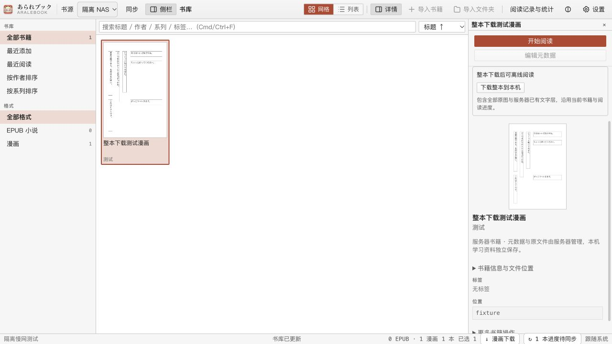
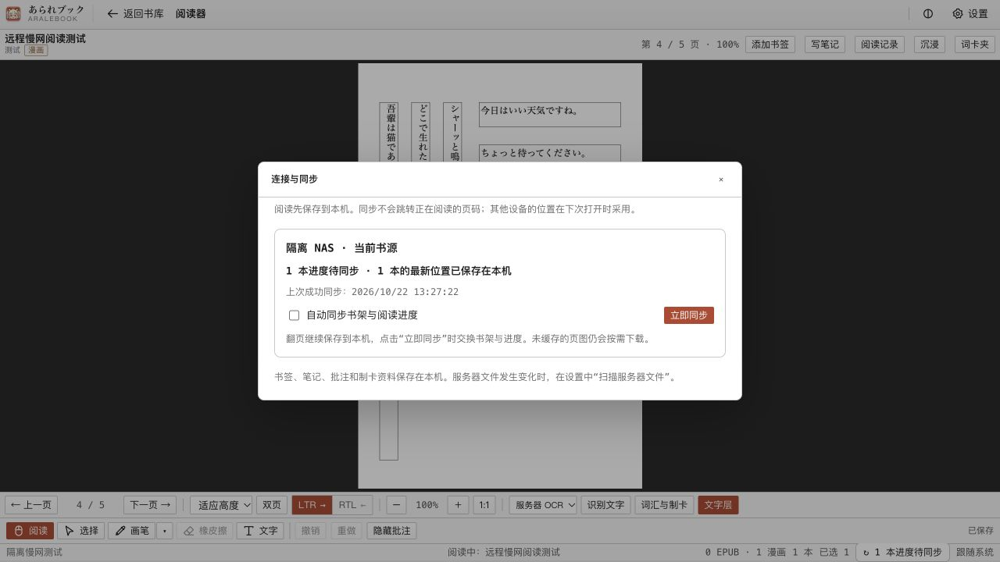

# Arale Server 与本地／远程书库

2026-10-19：第一版服务端已接入现有桌面客户端。本轮目标是本机跑通服务器 URL 配置、独立书源、远程漫画阅读、进度同步与服务端后台 OCR；没有连接或改动实际 NAS。

2026-10-20：已在实体 Ubuntu x86_64 NAS 独立部署 Docker 服务，实际远程读图、进度同步、后台 OCR 与重启持久化均通过。书库使用 Arale 专用目录；本次仅放入两页验收样本，未使用其他阅读服务的书库或个人漫画。平台、命令与边界见[实体 NAS 验收](server-docker.md#实体-nas-验收2026-10-20)。

## 服务器连接方式（2026-10-25）

「设置 → 服务器与书源 → 编辑连接」可选择连接方式：默认「跟随系统代理」保留原来的系统／环境代理行为；「直连（不使用代理）」由本机解析服务器域名并直接连接，适用于可直接访问的内网、VPN 或其他服务器。选择后可先「测试连接」，再「验证并保存」。此设置适用于该连接的书目、原图、进度与 OCR 请求；其他连接独立设置，LLM、翻译与扩展下载不受影响。

设置保存在本机 `remote/servers.json` 的每条连接 `proxyMode` 字段（`system`／`direct`）；旧配置缺失字段时按 `system` 处理，旧客户端编辑时未传字段则保留已有值。只改变连接方式可以留空令牌；修改 URL 仍需重新输入令牌并核验服务器身份。源码不按域名、地址段或组网产品特判。连接方式不会更改操作系统代理、DNS 或默认网关；直连仍要求当前设备能解析并访问该地址。

2026-10-25 / macOS arm64：`npm run typecheck`、`npm run build:renderer`、`CARGO_HOME="$PWD/.rust/cargo" RUSTUP_HOME="$PWD/.rust/rustup" .rust/cargo/bin/cargo test --manifest-path src-tauri/Cargo.toml --locked -- --test-threads=1`（55 通过／2 忽略）与同工具链 `cargo build --manifest-path src-tauri/Cargo.toml --locked` 通过。回环 HTTP／代理测试验证同一主机按选项选择路径、不同主机均可直连、探测不保存、编辑保留模式与令牌、切回系统、旧配置默认值及非法选项不覆盖配置；真实 ServersCard 浏览器夹具验证默认值、选择直连、测试、保存、编辑回填。隔离原生客户端使用显式直连，在终端代理与仅系统代理两种环境均读取真实 NAS 17 本书目、3 本书原图与已有 OCR。私人域名与令牌不入库；原生 GUI、Windows、外出中转与写入同步本轮未重新验收。

## 整本离线下载（2026-10-23）

书架顶部「同步」只交换书目与阅读进度；**整本原图下载是独立操作**：

1. 选择 NAS 书源；需要最新书目时先点击顶部「同步」。
2. 在书架选中一本漫画，在右侧「详情」点击 **下载整本到本机**。详情隐藏时先打开顶部「详情」。
3. 底部 **漫画下载** 查看队列、已校验页数与字节数；可暂停、继续或立即重试。多选远程漫画时，详情提供批量下载。
4. 显示「已完整下载」后，可在同一远程书源中断网打开该卷，不需要再次导入为本地书籍。已完成的书也可「检查并补齐」。



下载包含当前书目版本的完整页清单、所有原图、服务器已有文字层（没有 OCR 时写入空层）；沿用同一书籍 ID 和本机进度。所有缓存页先验算大小与 SHA-256，正确文件复用，损坏或缺失文件重新下载并原子替换。原本地书库、个人笔记／批注／词卡、本机 OCR 候选层与进度文件不作为下载写入目标。

队列保存于 `remote/downloads.json`，每书完成记录为 `offline-complete.json`。下载与书目／进度同步使用不同执行通道，切换阅读页不中断下载；退出应用保留队列，再启动后恢复，明确暂停的任务等待手动继续。连接失败按约 30 秒重试，前面的任务等待重连时保持其优先顺序。任务依照当前目录版本执行；内容版本变化会提示刷新书架后重新下载。已下载清单可直接从磁盘恢复，打开时无需等待其他同步请求。仍无缓存配额或自动清理；下载失败保留有效页面。

后台执行使用独立进程锁与队列状态锁，同一数据根只允许一个下载工作进程，其他实例仍可查询、暂停或添加任务。队列只读取服务器，不上传或解决阅读进度冲突；进度交换继续由「同步」完成。

2026-10-23 / macOS arm64 / Node 22.22.2：类型／前端／Rust 构建通过；Node 457 通过／1 跳过，Rust 54 通过／2 忽略，隔离服务端与原生双客户端 23/23。新增真实回环 HTTP 测试覆盖暂停／继续、损坏缓存修复、完整性标记、进度文件字节保持不变、仅有摘要时从已缓存清单离线打开；浏览器真实 App／BookDetail 验证下载按钮、暂停、续传、完成与全局队列。浏览器下载响应为隔离内存夹具，不代表实际 NAS 书籍下载完成。真实 NAS 当时离线，批量任务保持等待，尚无真实全库下载完成验收；原生窗口新入口及 Windows 未测。

## 远程书籍使用本机 OCR（2026-10-23）

NAS 书库的 OCR 选择器现在同时列出「本机 · 系统 OCR／ONNX」和「服务器 OCR」。打开应用、切换书源和读取 OCR 选项只读取本机能力，**不会为此请求 NAS 的 OCR 探测接口，也不弹出网络探测失败横幅**；服务器能力与连通性由用户点击开始识别后的实际请求检查。已有文字层的状态从本机缓存读取，按钮可显示「重新识别」。

选择本机引擎后，任务进入现有本机队列，先按清单补齐并校验远程原图，再执行本机识别与文字层转换；缓存阶段可取消，已下载页面保留。原图已全部缓存时可断网识别；缺页时仍需要网络，失败由这次手动任务反馈。选择服务器引擎仍提交 NAS 后台任务。

远程书的本机识别结果保存为独立 `remote-cache/<id>/local-ocr.json`，绑定内容版本并记录原服务端 OCR 修订号与本机引擎。阅读、查词、分词、截图与制卡统一优先读取匹配的本机文字层；服务器缓存刷新不会删除它，新版原图不会套用旧版结果。只有本机明确发起的服务器重新识别任务成功、且本机层自提交任务后没有再次修改，才切换为新的服务器文字层；旧本机文件继续保留。原本地书籍仍使用原 `content/manga.json`。

**目前本机 OCR 结果仅在本机使用，尚未上传到 NAS。** 下方上传方案仍为后续接口工作，本次没有修改 NAS 服务或私密配置。

2026-10-23 / macOS arm64 / Node 22.22.2：`npm run typecheck`、`npm run build:renderer`、Cargo check/build 通过；`npm test` 457 通过／1 跳过；Rust 串行测试 53 通过／2 忽略；`npm run server:test -- --native` 23/23。新增检查覆盖 OCR 列表不探测 NAS、本机 OCR 的启动／取消路由、本机层离线读取、服务器缓存不覆盖本机层、只接受主动请求的服务器结果、内容版本失配不误读及原制卡变更校验。真实组件夹具验证离线启动无探测横幅、主动服务器识别才显示连接失败、本机引擎与排队状态；实际 ONNX 0.2.0 仍以远程相对路径识别样本 1 页／7 块。该实际引擎实验与原生数据层测试分开执行，**未完成整个 Tauri GUI → 本机引擎的自动化端到端验收**；Windows／NAS 新部署／真实长卷离线识别未测。

## 缓存阅读与连接同步（2026-10-22）

当前桌面端允许本机进度暂时领先于服务器。进入远程书架先使用已缓存的书目；已经取得完整页清单的书可直接打开到本机保存的位置，不等待身份探测、上传队列或整卷文字层。首次连接和首次打开未缓存清单的书仍需要网络；未下载的页图也需要网络。更新不会迁移或覆盖原有本地书库。

UI 将三件事分开：

1. **书架顶部「同步」**：获取书目和两端进度；本地书库仍显示「刷新」。
2. **底部「连接与同步」**：书架与阅读器共用入口，显示待同步书数、连接／认证失败或冲突；展开后查看上次成功时间、开关自动同步、立即同步、选择冲突位置。关闭弹窗回到原页，Esc 不触发背后的阅读／书库快捷键。
3. **设置「扫描服务器文件」**：只请求服务器扫描原书目录，扫描完成后同步得到新书。它与本机进度上传是不同操作。



自动同步默认开启，旧配置缺少该字段时沿用开启状态。翻页先写本机持久队列，下一轮约 3 秒的后台调度上传；空闲时约 30 秒更新书架与其他设备位置。失败按 6／12／24／48／60 秒退避，手动同步可立即重试。关闭自动同步仍可保存阅读位置和手动交换书架／进度；连接与后台 OCR 状态继续定期检查，按需读图也继续。只有客户端运行时才会自动同步本机待传位置。

正在阅读的书收到其他设备位置时暂存，不跳页；下次打开采用该位置。如果本机也有新修改，仍按原基准修订号比较并显式处理冲突，不按页码大小选胜者。上传响应到达时重新读取队列，因此上传期间产生的新翻页不会被旧响应清除。进度提交携带打开时的内容版本，避免书架刷新后把旧版页码冒充新版位置。阅读器关闭时重复保存相同页不会产生新修改，因此不会阻止下次打开采用远端位置。待同步位置、冲突历史、开关和最近同步状态均可在重启后恢复。

性能改动：

- 新增 `GET /catalog?revision=…`，只携带每本书的元数据与封面页描述；完整页清单在打开单书时获取。目录版本未变时省去书目数组，但仍返回进度。旧 `/books` 保留，新客户端按能力检测回退，因此无需同时升级所有客户端／服务器。
- 同一页图的并发请求合并为一次校验下载。当前阅读页、书架封面／其他书资源、相邻预读分别最多 4／2／1 个下载；封面和预读不会占满阅读页的并发位置。快速翻页会丢弃尚未开始的旧预读，已开始的单个请求可完成并留下缓存。
- 页图仍校验大小和 SHA-256，原子落盘；保留按内容版本的页清单以读取旧版缓存。未变化的书目不重复写全库缓存。封面目前仍使用原图，没有新增缩略图服务；整书离线下载已于 2026-10-23 接入。

相关实现：`src-tauri/src/remote/sync.rs`（本机队列、自动／手动同步与状态）、`remote/assets.rs`（下载合并和调度）、`src/renderer/components/ServerSync.tsx`（同步 UI）。服务器数据 schema 与 API 主版本未变。**本轮只验证本机代码，尚未部署到 NAS**；精简书目接口需更新服务端才能生效，旧服务端仍可阅读和同步。

### 验证范围

2026-10-22，macOS arm64 / Node 22.22.2 / Cargo 1.98.1，使用独立临时书库、虚构令牌和回环 HTTP 服务：

- `npm run typecheck`、`npm run build:renderer`、`npm run server:build` 通过。
- `npm test`：457 项，456 通过、1 跳过。覆盖现有本地行为、打开时版本绑定、手动同步状态与书架刷新事件。
- `CARGO_HOME="$PWD/.rust/cargo" RUSTUP_HOME="$PWD/.rust/rustup" RUST_TEST_THREADS=1 .rust/cargo/bin/cargo test --manifest-path src-tauri/Cargo.toml --locked`：52 通过、2 忽略；活服务器测试由下一条命令单独执行，真实 RAR 样本测试本轮未执行。新增真实 HTTP 延迟响应验证上传期间继续翻页、下载去重；另验证旧预读取消、网络锁被占用时缓存打开／列表／落盘仍完成、重启保留待同步状态。
- `npm run server:test -- --native`：23/23。新精简接口及去掉新能力声明的旧 v1 网关都分别运行两个真实 Rust 客户端，验证读图、文字层、同步冲突、离线重试、关闭自动同步／重启后手动同步，以及本地文件保持不变。首次沙盒监听被 `EPERM` 阻止，在允许本机监听的环境重跑通过。
- 合成 15 本／3000 页书库：书目 JSON 从 **471,376 字节降至 10,443 字节（97.8%）**；这是响应体大小，不是实际 NAS 首屏或页图下载耗时。
- 浏览器使用真实 App／ComicReader／Settings 组件和隔离内存 IPC：关闭自动同步后从第 3 页翻到第 4 页出现待同步；手动同步清除待传状态，关闭弹窗仍是第 4 页；冲突选择清除提醒；离线状态保留书架和重试入口。截图：[冲突](images/remote-sync-2026-10-22/conflict.png)、[断网](images/remote-sync-2026-10-22/offline.png)。这不是原生 WebView 或真实网络端到端 GUI 验收。

本轮没有修改个人数据或连接实际 NAS；Windows、新版原生 GUI、NAS 更新后的实测延迟、长期弱网和大书库压力未验证。缓存仍无配额和自动清理。

### 本地 OCR 后上传：本机识别已接入，上传待实现

本机识别入口已于 2026-10-23 接入，见上方说明；下面保留上传部分的可行性依据。现有本地 runner 接受带远程内容版本前缀的相对页路径，`convertOcr` 与服务器复用相同文字层格式；不需要为 NAS 再训练或安装一套客户端模型。2026-10-22 在 macOS arm64 用现有 ONNX 0.2.0 对 `samples/ocr-fixture.png` 实际运行：1 页、7 块，远程相对路径保留，转换后的带页指纹示例载荷约 1,247 字节。该实验只验证识别与格式映射，**没有上传到服务器，也没有实现上传 API**。

完整上传流程按下面方案继续；第 1／2 项的整书缓存和本机队列已接入，第 3 项独立候选层已落盘，第 4／5 项上传接口与上传状态尚未实现：

1. 阅读器在「识别文字」旁选择「本机识别并同步」或「服务器后台识别」。本机选项使用已安装的系统／ONNX 引擎；服务器选项继续支持退出客户端后执行。默认保留用户上次选择，明确提示本机处理需要客户端保持运行。
2. 本机开始前补齐所选页原图并校验 SHA-256；现有原生 OCR 的 `run_job` 要求输入页已经在磁盘上，所以不能只把远程按钮路由到本地队列。首先支持整书已缓存后识别，随后再扩展逐页下载、识别和断点续跑。
3. 识别结果先存入独立的本机候选层，阅读可立即使用；上传前核对 `bookId + contentRevision + pageId + sha256`。不能直接复用现在可被远端刷新替换的 `content/manga.json` 作为唯一待传副本。
4. 增加带 `operationId`、`baseOcrRevision`、引擎版本／来源信息的认证上传接口。服务端校验文字框、尺寸和页面集合，使用修订号比较与幂等回执原子发布；服务端 OCR 正在执行或两边文字层都更新时返回冲突，保留双方结果。导入的文字层不能伪装成相同模型检查点，否则服务端续跑可能错误跳页。
5. 接入本轮同步窗口，显示「本机已识别／待上传／已同步／文字层冲突」，自动上传遵守同一开关，也允许手动上传；覆盖服务器已有结果需在可比较的预览中明确选择。失败保留候选层，成功后才更新服务器 OCR 修订号与本机层版本。

这条路径可以让性能更好的 PC／Mac 承担识别、NAS 负责统一存储；服务器 OCR 保留作为客户端离线时的另一种执行方式。它不等于把原本地书库或整份学习资料自动迁到服务器。

## 使用

在仓库根目录使用 Node 22.13+（本轮为 22.22.2）和 Rust 工具链：

```bash
npm ci
npm run build:native
npm run server:build
npm run server:start -- --library ./server-library --data ./.arale-server
```

`server-library` 放原始漫画压缩包或图片文件夹；`data` 存放服务端 SQLite、页图副本、文字层与 OCR 检查点，必须与扫描目录互不包含。默认监听 `127.0.0.1:3737`。首次启动自动生成 `data/access-token`，控制台只显示文件位置，令牌内容不写日志；也可通过 `ARALE_SERVER_TOKEN` 提供至少 16 字符的令牌。

桌面端打开「设置 → 服务器与书源」，填写名称、`http://127.0.0.1:3737` 和令牌，点击「测试连接／验证并保存」。返回书库后在顶部「书源」选择服务器，或在设置中点击「使用此书库」。切回「本地书库」即可继续使用原有数据。

启动时自动扫描，也可在服务器设置卡片中手动扫描。扫描任务后台执行；设置卡片显示扫描状态和错误，客户端轮询到扫描完成后刷新当前远程书库，顶部提供手动同步入口。导入按钮只用于本地书库；远程新增书籍先放入服务端扫描目录。

本机已有 `engines/arale_onnx_v1/build/dev-<平台>-<架构>/extension.json` 时自动选用其 OCR runner。也可显式指定：

```bash
npm run server:start -- --library /path/to/comics --data /path/to/arale-data \
  --ocr-manifest /path/to/installed-ocr/extension.json \
  --extractor /path/to/arale-native --host 127.0.0.1 --port 3737
```

对应环境变量为 `ARALE_SERVER_LIBRARY`、`ARALE_SERVER_DATA`、`ARALE_OCR_MANIFEST`、`ARALE_EXTRACTOR`、`ARALE_SERVER_HOST`、`ARALE_SERVER_PORT`、`ARALE_SERVER_NAME`。NAS／容器后续可通过 `--host 0.0.0.0` 监听局域网，并在可信网络或 HTTPS 反向代理后访问。客户端支持带路径前缀的 URL，拒绝 URL 内账号、查询参数、片段与重定向；修改地址必须重填令牌，保存时核对原服务器身份。

Linux Docker／Compose 与独立 Linux CPU OCR 运行环境现已提供，部署、目录／令牌配置和双架构验证记录见[Linux OCR 与 NAS Docker 部署](server-docker.md)。现有 macOS／Windows 桌面引擎包仍保持原分发方式；服务端不依赖桌面窗口、客户端 Worker 或 Anki。

## 数据归属与兼容

| 内容 | 原本地书库 | 服务器书库 |
|---|---|---|
| 书籍 ID／目录 | 原 `bk_*` 和 `library/<id>` 不变 | `rs_<serverId>_<bookId>`，独立 `remote-cache/<id>` |
| 原始漫画 | 客户端原有文件不变 | 读取扫描目录，页图发布到服务端数据目录的不可变内容版本 |
| 阅读位置 | 原 `positions.json` 不变 | 服务端 SQLite + 客户端持久待同步队列 |
| OCR | 原本地引擎与队列不变 | 可选服务器后台或本机识别；服务器层有检查点，本机层独立保存且暂不上传 |
| 词典、LLM／翻译配置 | 本机既有数据 | 继续复用本机配置 |
| 词卡、分词、批注、Anki 草稿 | 原书目录与原逻辑 | 保存在独立远程缓存书目录，复用同一原生逻辑 |
| 书签、摘录、笔记、阅读／学习统计 | 原 `reading-journal.json` | 继续记录在本机同一日志，使用带服务器命名空间的书 ID |
| 阅读方向 | 本地书元数据 | 本机 `preferences.json` 覆盖，不改服务器元数据 |

没有迁移、移动、上传或重写现有本地书库。相同文件同时在本地与服务端时是两份独立记录；本地学习资料不会自动挂到远程书，也不会同步到另一台客户端。不要把客户端整个数据根当作服务端数据根或原始漫画扫描目录。

连接配置保存在客户端 `remote/servers.json`，原生层注入 Bearer 令牌；返回渲染层的连接信息只有 `hasToken`。`remote/catalog.json` 是远程元数据缓存，`remote/outbox.json` 索引有待同步／冲突的书籍，用于判断是否需要即时后台同步；状态面板另外读取各书的本机状态。移除连接保留缓存和本机学习资料，重新连接同一服务器沿用稳定书 ID。

原图经原生 HTTP 按需下载，校验清单中的字节数和 SHA-256 后原子落盘，再通过现有被动图片 `arale://` 协议提供；服务端绝对路径不进入客户端清单。离线时可阅读已缓存页面，未缓存页面需要恢复连接。整书下载见上方入口；没有缓存配额或自动清理；手工清理前要注意远程缓存书目录也含本机学习资料。

OCR 文字层转换复用 `core/ocr/convert.ts`，服务端与本地 Worker 使用相同的排序、块合并和 manga.json 序列化。远程文字层缓存后，查词／分词／制卡仍走原流程；制卡验证和截图会先补齐所需原图。批注可使用已校验清单里的原图指纹绑定尚未下载的页面，已缓存文件仍实际验算指纹。

## 远程阅读打开与文字层加载（2026-10-21 历史验证）

2026-10-22 已由上方缓存优先与后台同步流程更新打开行为，下述耗时仅代表 10 月 21 日实现。

开始／继续阅读按钮会立即显示“打开中…”并防止重复提交。远程阅读仍先核验服务器身份并取得正确阅读位置，避免先显示第一页后覆盖已有进度；整卷 OCR 改为进入阅读器后在后台加载。原图按原有方式校验并缓存，文字层加载期间可继续翻页。

客户端传输层为交互打开启用 `remote:open` 的延后文字层选项，普通原生调用仍保留文字层就绪后返回的契约。传输层去重同书后台下载并发布 `book:textLayer` 状态；完成时仅清除漫画的页文字缓存，重新读取当前页，不重建阅读器或重置页码／缩放／批注。分词和制卡会等待该书正在进行的文字层下载；下载失败显示错误，原图阅读继续，重新打开可重试。

`remote:refreshLayer` 只请求目标书的清单，保留其他书缓存；内容版本与打开时不同则拒绝应用，提示返回书库刷新。清单表明没有 OCR 时，本机生成空文字层，省去无内容的请求。进度队列为空时不再执行额外的身份探测；有待同步操作时继续执行原身份校验、幂等与冲突规则。

2026-10-21 / macOS arm64 / Node 22.22.2：`npm run typecheck`、`npm test`（449/449）、`RUST_TEST_THREADS=1 npm run tauri:test`（含 Vite 构建；Rust 46 通过／2 忽略）、`npm run server:test -- --native`（19/19）通过。新增检查覆盖打开不等待文字层、下载去重、学习操作等待、错误重试、内容版本拒绝及本地功能兼容。浏览器运行实际 App／阅读器组件，以延迟回执验证按钮立即反馈、从第 3 页继续阅读、下载期间翻到第 4 页、文字层到达后仍在第 4 页且未额外保存旧页码。

同一 Mac 通过 EasyTier 对同三本实际 NAS 漫画使用隔离冷缓存客户端，仅允许 GET，请求不写阅读进度。测量的是原生打开调用返回书籍／阅读位置的时间，不包含首张页图传输和后续 OCR 下载；每本一次顺序测量，网络状态会影响数值：

| 样本 | 修改前 | 修改后 |
|---|---|---|
| 1 | 1.869 秒 | 0.349 秒 |
| 2 | 1.172 秒 | 0.337 秒 |
| 3 | 1.078 秒 | 0.345 秒 |

随后原图与文字层均可读取，进度及文字块数一致。脱敏结果见[验证报告](validation/remote-open-2026-10-21/summary.json)。本轮未重新部署服务端；未验收新版本原生 WebView GUI、Windows、大量并发或持续弱网，后台文字层下载仍受带宽影响。

## 进度同步

每份位置包含内容版本、服务器修订号、设备 ID 和幂等操作 ID。客户端先原子保存待上报位置，再发送请求；断网不丢本机位置，重连轮询时重试。请求已经成功但响应丢失时，使用原操作 ID 取回相同回执，然后才发送下一份位置。

服务器按修订号比较后写入，支持正常回读；同一页的重复上报不增加修订号。两台设备从不同状态继续时返回 409 和当前服务器位置，两边位置均保留；底部同步状态窗口提供「采用本机位置／采用服务器位置」。采用服务器位置后先返回书库再重新打开，旧阅读器卸载时不会把已放弃位置重新提交。

漫画页清单变化会产生新内容版本。旧内容版本的待同步位置不会覆盖新版本；没有待同步修改时，重新打开新版本从未定位状态开始。遇到内容版本冲突，提示先刷新书库，再通过「从新版第一页开始」重新定位；旧的两边位置原子保存到本机 `progress-conflict-history.json`。第一版未做页内容重排匹配，不把旧版页码自动套到新版。

## 后台 OCR 与恢复

任务入队后由服务器 FIFO 串行运行，一本书同一内容版本同时只有一个活动任务。客户端关闭、切书源或离开阅读页都不停止服务器任务。客户端约每 3 秒轮询队列；完成后先缓存文字层，再发布现有 `ocr:done` 事件，阅读器刷新文字层。

SQLite 保存任务、尝试次数、逐页成功结果；检查点按书、内容版本、页 ID 与实际模型／runner 指纹隔离。服务端重启后把运行中的任务重新排队，只处理缺页。重新识别会清除该版本检查点；取消后保留已发布文字层。返回失败／缺页的进程不会发布不完整的新层，漫画内容变更也阻止旧结果成为当前版本。队列入队重试和活动任务去重共享持久回执，任务完成后仍保持幂等。

一个服务端数据目录只能运行一个服务进程，使用定期更新的文件租约防止两个 OCR worker 同时写入。租约按修改时间过期，容器重建改变主机名／PID 也能恢复，容器启动最多等待约 15 秒恢复异常退出的锁；旧版 PID 锁仅在确认本机原进程退出时迁移。服务端数据库为 SQLite WAL，启动不自动重建坏库。备份时停止服务并保存整个服务端数据目录及原始漫画目录；客户端学习资料需另备份其数据根。

## 接口与代码

接口前缀 `/api/v1`，除 `/health` 外均需 `Authorization: Bearer <token>`。第一版固定单一 `owner` 空间，尚无多账号权限系统。

| 接口 | 用途 |
|---|---|
| `GET /info`、`GET /state` | 服务器身份、API 能力、扫描状态、任务 |
| `GET /catalog?revision=…` | 精简书目、条件响应与阅读位置快照（新增能力） |
| `GET /books`、`GET /books/:id` | 漫画清单、页清单、内容版本 |
| `GET /books/:id/pages/:pageId?revision=…` | 认证图片流、ETag、版本校验 |
| `GET /books/:id/ocr?revision=…` | 当前文字层和文字层修订号 |
| `GET /books/:id/progress`、`PUT /books/:id/progress` | 读取位置、带修订号与幂等键的同步 |
| `POST /books/:id/ocr-jobs` | OCR 入队／重识别 |
| `POST /jobs/:id/cancel` | 取消服务器任务 |
| `POST /library/scan` | 后台扫描书库 |

`server/src/{app,storage,library,ocr}.ts` 分别处理 HTTP、SQLite、扫描发布与任务；`src-tauri/src/remote.rs` 负责连接、凭据、HTTP、缓存和进度重试；`core/remote-transport.ts` 按书 ID 分发请求与合并队列，当前选中书源只影响书库列表和默认 OCR 能力。原本地导入、词典、阅读记录、批注和 study Worker 的 API 保留。

## 验证：2026-10-19

平台：macOS arm64，Node 22.22.2，Cargo 1.98.1。测试使用临时书库、独立服务端目录和独立客户端数据根，不读取或写入正式个人书库。

- `npm run typecheck`：renderer、core/tests、server 类型检查通过。
- `npm run server:build`、`npm run build:native`：服务端 bundle 与原生解包器 release 从源码构建通过。解包器补齐仓库工具链的探测环境；沙盒首次下载缺失 Rust 依赖失败，在允许访问配置代理的环境重跑通过。
- `RUST_TEST_THREADS=1 npm run tauri:test`：Vite 生产构建、Rust 编译通过；Rust 45 通过、2 忽略。忽略项分别为需要外部真实 RAR 的既有测试和需要活服务器的远程测试；后者由下述集成命令单独实际执行。
- `npm test`：442 项，441 通过、1 跳过，0 失败；涵盖本地路由不变、按书 ID 路由远程操作、队列合并、完成发布顺序与本机阅读方向偏好。
- `node scripts/test-tauri-ocr.mjs`：3/3；`node scripts/test-tauri-study.mjs`：6/6。后者包含预期的磁盘失败注入日志，最终断言通过。
- `npm run server:test -- --native`：19/19；真实 HTTP + 两个真实 Rust 客户端验证图片／文字层、分词输入、本地文件字节不变、偏好持久化、进度 CAS 冲突／采用远端／断网重试／内容版本冲突重新定位与历史保留，以及 OCR 检查点重启恢复、请求别名幂等与取消。服务器监听本机回环端口需在允许监听的环境运行；沙盒内首次因 `EPERM` 失败后在授权环境重跑通过。
- `npm run server:test -- --real --native`：17/17；使用已有 ONNX 包实际识别 `samples/ocr-fixture.png` 两页。独立客户端子进程提交请求后立即退出，服务器继续完成识别，第二个原生客户端实际读取文字层和原图，并验证同步与本地数据隔离。
- 真实 React App／SettingsPanel／LibraryView／ComicReader 浏览器夹具连接本机真实服务，操作验证保存连接、切换书源、远程阅读、后台 OCR 入队后切回本地、完成后读到文字层与页码恢复。夹具替代原生 IPC，不等于 macOS WebView GUI 验收。原生窗口通过调试进程尝试启动，CUA 未能绑定窗口，未把这次尝试记录为 GUI 通过。

界面证据：[服务器设置](images/server-2026-10-19/connection.png)、[远程阅读](images/server-2026-10-19/reader.png)。截图使用隔离测试 URL 与样本，不含个人漫画或访问令牌。

尚未验证 Linux／NAS／Windows 目标机运行、反向代理／HTTPS、完整原生 WebView GUI、多用户、超大书库和长时间压力；本轮没有发布安装包或部署到实际 NAS。首版远程书源仅支持漫画，现有本地 EPUB 继续使用原实现。上传／双向迁移、本机学习资料跨设备同步、远程 EPUB 与缓存配额／清理留待后续；整书离线下载已接入。
